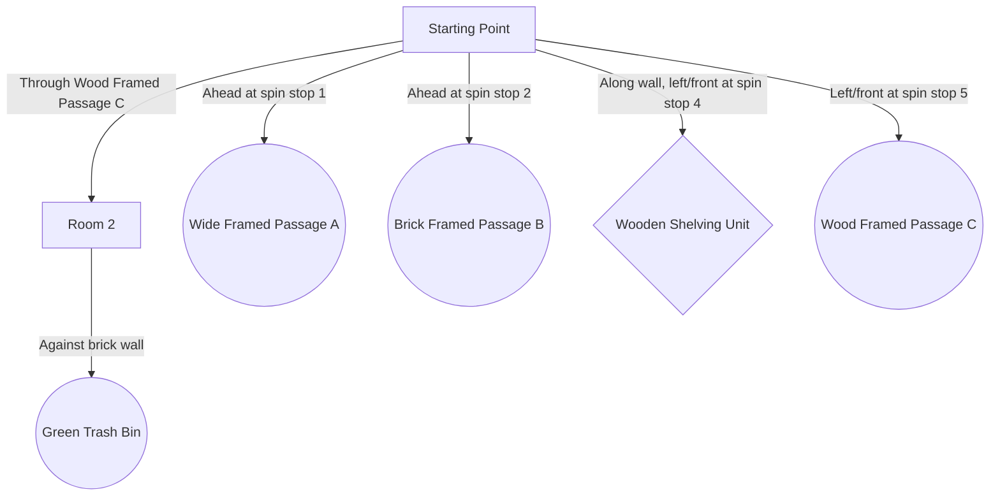
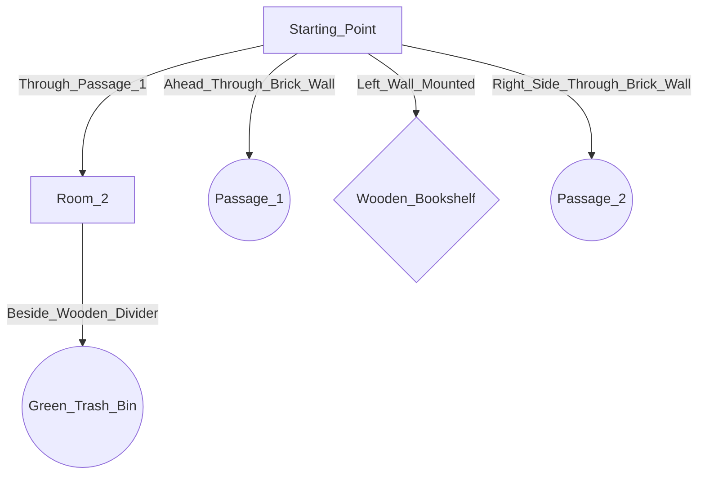
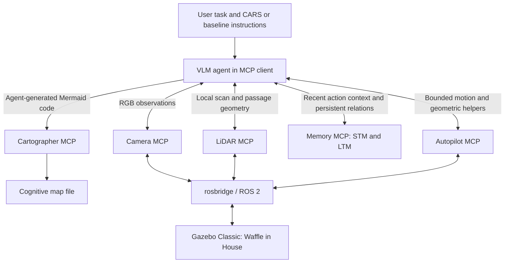

# CARS - Cognitive Autonomous Robot System

[](https://www.python.org/) [](https://docs.ros.org/en/humble/) [](https://releases.ubuntu.com/22.04/) [](https://gazebosim.org/) [](#architecture) [](#known-limitations) [](LICENSE)

CARS is an experimental semantic navigation architecture for a mobile robot operating without a persistent dense metric map. It combines online RGB camera observations, 2D LiDAR, odometry, a multimodal language-model agent, and sparse topological memory.

The current prototype runs on ROS 2 Humble with a TurtleBot3 Waffle in the TurtleBot3 House world using Gazebo Classic 11.10.2. Experiment scenarios reuse this world with modified object placements. Robot capabilities are exposed to the agent through five Model Context Protocol (MCP) servers. The language model performs task-level semantic reasoning; motion execution and immediate collision checks remain in deterministic ROS-facing tools.

> **Project status:** `v0.1` is a simulation-only experimental prototype. It has not been validated on a physical robot and should not be treated as safety-certified navigation software.

## Table of contents

- [Problem and research question](#problem-and-research-question)
- [CARS Protocol Passage Navigation Example](#passage-navigation--multi-door-choice-cars-protocol)
- [Architecture](#architecture)
- [Safety mechanisms](#safety-mechanisms-in-v01)
- [Requirements and installation](#requirements)
- [Tested language models](#tested-language-models)
- [Running the simulation](#running-the-simulation)
- [Example LLM commands](#example-llm-commands)
- [Tests](#tests)
- [Logs and runtime state](#logs-and-runtime-state)
  - [Start a controlled experiment](#start-a-controlled-experiment)
- [Repository structure](#repository-structure)
- [Known limitations](#known-limitations)
- [Reproducing the experiments](#reproducing-the-experiments)
- [Selected simulation results](#selected-simulation-results)
- [Demo video](#demo-video)
- [Future work](#future-work)
- [Citation](#citation)
- [License](#license)
- [Model latency and token-efficiency logging](#model-latency-and-token-efficiency-logging)

## Problem and research question

Recognizing a target is not enough to navigate to it: the agent must associate range measurements with the correct object, choose a traversable approach, and verify what happened after motion. Reaching that target also does not guarantee that the stored environment representation supports a later return journey. CARS investigates these gaps through an explicit observation, memory, action, and verification protocol.

Can a protocol-grounded vision-language agent complete semantically meaningful navigation tasks using online camera, LiDAR, and odometry observations, while maintaining only sparse topological-semantic memory instead of a persistent dense occupancy map?

CARS is **SLAM-less, not pose-free or memory-free**: it uses odometry-derived poses and local range measurements without running a SLAM process or constructing a SLAM map. It does not claim that localization or SLAM is generally unnecessary, or that mapping-degraded operation has been experimentally established. Comparison with classical and hybrid SLAM/Nav2 systems remains future work.

## Passage Navigation & Multi-Door Choice (CARS Protocol)
In this scenario, the robot is placed in a separate room from the target. It must autonomously survey the environment, evaluate multiple doorway candidates, and select a safe passage to reach the target in the adjacent room.

### Preparatory 360° Exploration Spin
This example is Experiment 3, Pose 2. All four model/protocol conditions received a separately requested six-stop survey before the target command; the GIF illustrates that preparation for a CARS run. The survey lets the agent record observed openings and landmarks, without guaranteeing a complete map. Under the general CARS Stage 0 procedure, reliable target identification can end a target-search spin early.

<p align="center">
  
  <br>
  <em>Timelapse of the initial environment survey.</em>
</p>

### Autonomous Route Selection & Target Approach
After the survey, the two CARS runs selected different routes: GPT selected the left passage and bin, while Gemini selected the right passage and bin in the overhead view. Both instances satisfy the category-level task. Reported final target ranges were 0.31 m for GPT and 0.37 m for Gemini, within the accepted 0.30 m +/- 0.15 m tolerance; this is not a matched-destination route-efficiency comparison.

| GPT (Selected Left Passage) | Gemini (Selected Right Passage) |
| :---: | :---: |
|  |  |
| *GPT navigates through Wood Framed Passage C.* | *Gemini navigates through Passage 1.* |

### Generated Cognitive Topological Maps
Below are the final agent-authored `Mermaid` maps saved by the Cartographer MCP tool. The agent composes the graph using its memory; Cartographer saves the supplied graph rather than automatically converting LTM or validating its contents. GPT labels below use display-friendly spacing; the archived outputs are in [GPT map](assets/cognitive_map_gpt_cars.md) and [Gemini map](assets/cognitive_map_gemini_cars.md).

#### GPT Map


#### Gemini Map


## Architecture



GPT and Gemini, under both full CARS and reduced baseline instructions, have access to the **same five servers and all 20 tools** (18 navigation/memory tools and two optional stage-timing tools). The experimental difference is the rule set, not tool availability. STM retains recent action/outcome context; LTM stores places, objects, and relations for reuse. Cartographer saves the agent's representation, rather than independently discovering relationships or validating a route. Autopilot executes bounded commands with sensor feedback; it is not an independent semantic planner.

| Component                     | Path                                   | Responsibility                                                                                      |
| ----------------------------- | -------------------------------------- | --------------------------------------------------------------------------------------------------- |
| Autopilot                     | `modules/autopilot_mcp.py`             | Motion execution, odometry-based feedback, safety checks, target and topological route calculations |
| Camera                        | `modules/camera_mcp.py`                | Fast and detailed RGB observations                                                                  |
| LiDAR/Radar                   | `modules/lidar_mcp.py`                 | 360-degree LiDAR visualization and passage-width analysis                                           |
| Cartographer                  | `modules/cartographer_mcp.py`          | Mermaid topological-map output                                                                      |
| Cognitive memory              | `modules/custom_memory_mcp.py`         | Short-term and long-term memory (STM/LTM)                                                           |
| Master protocol (Full)        | `rules/CARS_MASTER_PROTOCOL.md`        | Full agent protocol: Stage 0 strategic routing, execution loop, and beyond-passage tracking         |
| Master protocol (Baseline)    | `rules/BASELINE_MASTER_PROTOCOL.md`    | Reduced behavioral instructions; the complete shared tool set remains available                     |
| System instruction (Full)     | `rules/CARS_SYSTEM_INSTRUCTION.md`     | Operational prompt configuring the agent for the full protocol                                      |
| System instruction (Baseline) | `rules/BASELINE_SYSTEM_INSTRUCTION.md` | Operational prompt configuring the agent for baseline evaluation runs                               |

The agent follows a hierarchical loop:

1. Interpret the task and select a high-level route strategy.
2. Read short-term and long-term memory.
3. Combine camera semantics with current LiDAR geometry.
4. Propose a bounded motion or recovery action.
5. Execute the action through the deterministic autopilot.
6. Verify the result and update memory and the topological map.

The current protocol includes explicit procedures for occlusion checks, obstacle bypass, oscillation detection, passage verification, cross-room observations, and sensor-grounded task completion.

## Safety mechanisms in v0.1

The autopilot currently includes:

- fail-closed motion checks when ROS, LiDAR, or odometry is unavailable;
- rejection of stale LiDAR and odometry data;
- odometry-feedback control for rotation and translation;
- bounded rotation and translation commands;
- motion timeouts;
- live frontal-distance monitoring;
- direction-aware near-field LiDAR checks;
- motor stop on sensor or connection loss;
- reporting of measured rotation and travelled distance.

These mechanisms are research safeguards, not formal or certified safety guarantees.

## Requirements

- Ubuntu 22.04
- ROS 2 Humble
- Gazebo Classic 11.10.2 (the legacy Gazebo Classic series, not the newer Gazebo series), with `turtlebot3_gazebo` and `turtlebot3_description`
- TurtleBot3 Waffle robot model and TurtleBot3 House world
- `rosbridge_server`
- Python 3.10 or later
- An MCP-compatible multimodal language-model client

After installing ROS 2 Humble on Ubuntu 22.04, install the simulation and bridge packages:

```bash
sudo apt update
sudo apt install ros-humble-turtlebot3-gazebo ros-humble-turtlebot3-description ros-humble-rosbridge-server python3-venv
source /opt/ros/humble/setup.bash
```

The exact historical Gazebo patch version may not be supplied by current package repositories; verify with `gazebo --version` and do not assume a newer Gazebo distribution is interchangeable. The local `src/` and `ros-mcp-server/` directories are excluded from this repository; the launcher uses installed ROS packages, not a bundled world distribution.

From the cloned repository root, create an isolated Python environment and install dependencies:

```bash
python3 -m venv .venv
source .venv/bin/activate
python3 -m pip install -r requirements.txt
```

The v0.1 environment has been verified with `fastmcp` 2.14.2, `mcp` 1.25.0, `roslibpy` 2.0.0, `numpy` 1.26.4, Pillow 10.1.0, and OpenCV (`cv2`) 4.5.4. In the verified Ubuntu/ROS environment, OpenCV is supplied by the Ubuntu `python3-opencv` package. `requirements.txt` pins the Python packages used by the prototype and permits an OpenCV 4.x pip installation for environments that do not provide `cv2` as a system package.

## Tested language models

CARS has been exercised through MCP-compatible clients with the following models:

| Model                       | Client used in the main 24-run study | Scope                                   |
| --------------------------- | ------------------------------------ | --------------------------------------- |
| GPT-5.6 Sol (`gpt-5.6-sol`) | Codex 26.930.31730                   | 12 runs: six full CARS and six baseline |
| Gemini 3.8 Flash            | Google Antigravity 2.19.1            | 12 runs: six full CARS and six baseline |
| Opus 5                      | Not part of the reported comparison  | Earlier workflow testing only           |

The experiments used desktop clients, not a custom provider-API evaluation harness. Provider token usage and monetary cost were not measured. The separate four-stage supplementary sequence used Gemini 3.8 Flash in Antigravity with medium effort; it is not part of the 24-run comparison.

In this repository, **MCP-compatible** means that the client can expose the tools and pass their visual/text outputs to the model. It is not a guarantee of correct protocol adherence or equivalent accuracy, latency, cost, or safety. The selected demonstrations are not a general cross-model benchmark.

For reproducible experiments, record the exact model identifier or snapshot, client/host application, run date, protocol revision, and any exposed reasoning or sampling settings.

## Running the simulation

The v0.1 experiment environment uses **Gazebo Classic 11.10.2**, **TurtleBot3 Waffle**, and **TurtleBot3 House**. `start_robot.sh` sets `TURTLEBOT3_MODEL=waffle` and launches `ros2 launch turtlebot3_gazebo turtlebot3_house.launch.py`. The experiments modify object placements in the existing world; reproducing an individual condition also requires its recorded robot and object placements. This setup documents the legacy simulator used for the experiments and does not imply compatibility with newer Gazebo releases.

From the repository root, start Gazebo and rosbridge:

```bash
bash start_robot.sh
```

The servers use MCP's default **stdio transport**. Configure the client to launch and own each server process; launching them in unrelated terminals does not connect them to the client. Start from [config/mcp_servers.example.json](config/mcp_servers.example.json): replace `/home/name/ros2_ws` with your checkout location and, if using the environment above, replace the `python3` argument with `/absolute/path/to/ros2_ws/.venv/bin/python`. The example targets Windows clients launching Ubuntu through WSL. For a native Linux client, use that Python executable directly and supply an absolute module path.

The five process entry points are (shown with the environment active):

```bash
python3 modules/autopilot_mcp.py
python3 modules/camera_mcp.py
python3 modules/lidar_mcp.py
python3 modules/cartographer_mcp.py
python3 modules/custom_memory_mcp.py
```

Configure the MCP-compatible client to use these five servers. Supply the following files as the agent's protocol context:

For the full CARS protocol:

```text
rules/CARS_MASTER_PROTOCOL.md
rules/CARS_SYSTEM_INSTRUCTION.md
```

For the reduced-protocol baseline evaluation (same tool access):

```text
rules/BASELINE_MASTER_PROTOCOL.md
rules/BASELINE_SYSTEM_INSTRUCTION.md
```

The system instruction defines `wake up` as a special **initialization and diagnostic** instruction: it prepares the agent's operational state and checks functional readiness. It is not a shell command or a standalone MCP tool. Confirm readiness before issuing a navigation task. ROS-facing servers expect rosbridge at `127.0.0.1:9090`.

## Example LLM commands

After connecting the five MCP servers and supplying the protocol files, give the
agent short, natural-language tasks. It will select and sequence the required
camera, LiDAR, memory, planning, and motion tools.

```text
wake up
Perform a full 360-degree exploration spin and record the important landmarks.
Find the red chair and approach it until you are about 0.5 meters away.
Pass through the nearest safe doorway and describe the room beyond it.
Find the fire extinguisher, using known rooms and passages if necessary.
```

Object names and distances are examples; replace them with the task you want to
run. These commands are intended for the Gazebo simulation described below.

## Tests

The repository audit found 12 logging regressions and 10 model-metrics tests passing. These results do not certify live motion, and no all-tests-passing badge is claimed. Re-run the explicit offline suites after changes:

```bash
python3 -m unittest discover -s tests -p test_experiment_log.py -v
python3 -m unittest discover -s tests -p test_model_metrics.py -v
```

Do not use unrestricted test discovery: importing the live durability harness can start a ROS-connected run.

The test harness in `tests/` is intended to cover missing or stale sensor data, motion timeouts, forward and rear obstacle responses, and normal motion with measured-result reporting.

Run the Python harness from the repository root with the module directory on `PYTHONPATH`:

```bash
PYTHONPATH="$PWD/modules" python3 tests/test_durability.py
```

The integration launcher is:

```bash
bash tests/run_tests.sh
```

Some integration cases depend on the robot's spawn pose and active Gazebo world. A skipped environment-dependent test is not evidence that the associated behavior is correct. Before publishing results, use controlled spawn poses and retain the resulting logs. See `tests/README.md` for the current design and known prerequisites.

## Logs and runtime state

Runtime state is intentionally excluded from version control:

- `logs/` contains the shared JSONL records produced by instrumented MCP tools.
- `logs/current_run.txt` identifies which `run_<id>.jsonl` file the MCP server processes share.
- `memory/long_term_memory.json` stores topological-semantic long-term memory.
- `memory/short_term_memory.json` stores the six-entry STM window.
- `memory/cognitive_map.md` is the generated Mermaid representation.

All five MCP servers use the same active JSONL file. The log and memory paths are resolved from each module's physical file location, so they do not depend on the shell's current working directory.

### Start a controlled experiment

Before each experiment, from the repository root:

```bash
python3 modules/experiment_log.py --metadata '{"scenario":"direct_target","model":"exact-model-id","target":"chair","initial_pose":{"x":0,"y":0,"yaw":0},"protocol_revision":"git-commit","variant":"full"}'
```

The command prints a fresh run-id and atomically switches `logs/current_run.txt`.
Use `--run-id video_01` for a named run; an existing ID is rejected to prevent
accidental experiment mixing. This starts recording context; it does not launch
Gazebo, move the robot, or clear memory. Preserve initial memory with your experiment.
Restart the five MCP servers once after installing this code update. Subsequent
run switches are picked up on every new tool call without restarting servers.
Stop issuing calls and wait for outstanding calls before changing experiments.
If a switch happens during a call, its end remains in the run where it started.
Without a marker, the first call creates one shared automatic run; a controlled
experiment must still explicitly start a fresh run. `CARS_LOG_DIR` optionally
overrides the log directory; set the same absolute path for every server and CLI.

All 20 currently registered tools across the five servers are instrumented:
camera observation, LiDAR radar/passage/laser/safety measurements, memory reads
and writes, pose/target/route calculations, autopilot motion, map updates, and
optional observed-stage timers.
Each invocation writes `tool_start` and `tool_end` events with the same `call_id`
and `run_id`. `seq` is a process-safe, increasing event order within a run;
read the `tool_start` rows in this order to reconstruct call entry order.
Concurrent calls can overlap and complete in a different order. UTC timestamps,
server/tool names, all bound inputs, elapsed seconds, and outputs or exceptions
are retained. Sequence gaps can indicate an interrupted write. A start without
an end indicates an unfinished or interrupted call.

`tool_end.status=returned` only means the function returned: a returned sensor
error, safety stop, or timeout remains visible in `output_summary` and is **not** a
success assertion. `status=exception` includes the exception type and message.
Text results are preserved without the old 300-character truncation. Images
are represented by MIME type, base64 length and SHA-256 of the base64 string;
the JSONL does not archive image pixels. These are tool traces, not model
reasoning traces; MCP requests rejected during schema validation before tool
entry are outside this logger. Logging failures propagate rather than silently
allowing an unrecorded invocation to begin. Filesystem locking uses Linux
`flock`, matching the supported Ubuntu/WSL runtime.

The durability harness starts a fresh run automatically and appends per-case
`test_result` events plus a `test_summary`. Its exit codes are 0 (all passed,
none skipped), 1 (failures), 2 (setup/import error), and 3 (incomplete/skipped).
Run the isolated logging and summary regressions without Gazebo:

```bash
python3 -m unittest discover -s tests -p test_experiment_log.py -v
```

## Repository structure

```text
.
|-- config/
|   `-- mcp_servers.example.json
|-- modules/
|   |-- experiment_log.py
|   |-- autopilot_mcp.py
|   |-- camera_mcp.py
|   |-- custom_memory_mcp.py
|   |-- cartographer_mcp.py
|   `-- lidar_mcp.py
|-- rules/
|   |-- CARS_MASTER_PROTOCOL.md
|   |-- BASELINE_MASTER_PROTOCOL.md
|   |-- CARS_SYSTEM_INSTRUCTION.md
|   `-- BASELINE_SYSTEM_INSTRUCTION.md
|-- tests/
|   |-- README.md
|   |-- run_tests.sh
|   `-- test_durability.py
|-- memory/                  # runtime-generated; ignored by Git
|-- logs/                    # runtime-generated; ignored by Git
|-- start_robot.sh
|-- requirements.txt
|-- .gitignore
|-- LICENSE
`-- README.md
```

## Known limitations

- Simulation-only validation; no physical-robot experiments yet.
- No benchmark comparison with Nav2, SLAM, frontier exploration, or published vision-language navigation systems yet.
- Passage-width estimation is heuristic and environment dependent.
- Topological route planning currently uses unweighted breadth-first search.
- Runtime memory uses JSON files without transactional concurrency guarantees.
- Behavior remains sensitive to the selected language model and protocol interpretation.
- Successful target approach can coexist with incomplete LTM records, missing relationships, or falsely claimed camera centering. A range reading must be associated with the intended target, not a nearby wall or furniture surface.
- The supplementary return attempt failed despite a retained room connection. Reliable inter-room backtracking is not an established capability; breadcrumb route retention is future work.
- Written tool-use restrictions are not enforced access boundaries. Terminal access was deliberately left available in the experiments, and the supplementary agent used PowerShell outside the prescribed robot-tool workflow. Client-side restrictions are available, but preventing that action is distinct from demonstrating behavioral compliance.
- The current durability tests are an initial harness, not a complete verification suite.
- Controlled experiments require the explicit start command; images and model reasoning are not archived in JSONL.
- Dynamic obstacles, network latency, API cost, and sim-to-real transfer are not yet systematically evaluated.

## Reproducing the experiments

The manuscript identifies the experiment release as **CARS v0.1**. When publishing, preserve the intended source and protocol snapshot with a release tag and commit identifier; the current development branch alone is not an immutable experiment reference. A tag should identify the reviewed snapshot, not imply that later commits were used in earlier runs.

1. Use the environment above and the release snapshot. Configure all five servers identically for both protocols.

2. Recreate the selected task's robot pose/orientation and object placements in TurtleBot3 House. The main study has three task environments, two initial configurations, two models, and two protocols: **24 runs**, not 24 repetitions of one identical condition.

3. Preserve the intended initial memory and use a fresh client session for an independent condition. Archive previous runtime state before resetting it; changing the log run ID does not reset memory or Gazebo. Load only the selected protocol pair and perform initialization/diagnostics.

4. For **Experiment 3, Pose 2**, perform the preparatory 360-degree room survey for all four model/protocol combinations and retain that survey's memory. This is part of the condition, not an additional independent trial.

5. Start a fresh JSONL record as described above, including the condition and exact task prompt. Keep the same prompt in every main run:
   
   ```text
   Find the green trash bin and approach it, positioning yourself exactly in the center at a distance of 30 cm (0.3 meters).
   ```

6. Let the agent execute without corrective navigation intervention. Preserve JSONL, STM/LTM, the cognitive map, and visual execution evidence, including the terminal position.

7. Evaluate approach to the **correct target** within 0.30 m +/- 0.15 m. Assess camera centering and protocol compliance separately; a distance to the wrong object is not success. In Experiment 3, Pose 2, either eligible bin can satisfy the category-level instruction; passage selection is autonomous.

### Robot and target setup positions

The table transcribes the planar positions visible in the archived Gazebo property-panel screenshots. Values are approximate, in metres; the screenshots crop the trailing decimal digits. These are condition-level setup records shared across the two models and two protocols, not independent initial-pose measurements for all 24 runs. They are not the odometry coordinates recorded by MCP tools, and no world-to-odometry transform is assumed.

| Experiment | Pose | Robot panel x (m) | Robot panel y (m) | Target relative placement (x, y), m |
| --- | --- | ---: | ---: | --- |
| 1: Unobstructed target | 1 | -2.00 | 4.00 | (0.00, 0.00), unchanged simulation placement |
| 1: Unobstructed target | 2 | -2.00 | 3.99 | (0.00, 0.00), same target as Pose 1 |
| 2: Thin foreground occlusion | 1 | -3.00 | 2.00 | (0.00, 0.00), unchanged simulation placement |
| 2: Thin foreground occlusion | 2 | -3.00 | 1.70 | (0.00, 0.00), same target as Pose 1 |
| 3: Target in another room | 1 | 6.00 | 1.00 | (5.00, -6.50) |
| 3: Target in another room | 2 | 5.00 | 3.00 | (-1.00, 2.00) and (5.00, -4.50) |

**Coordinate frames:** in Experiments 1 and 2, (0, 0) denotes the target's unchanged default placement in its relative frame, **not the world origin**. Experiment 3 target values also retain the displayed relative placement readings; their world-frame transforms are not established here. The cropped panels do not establish a common reference frame for robot and target readings: do not subtract these values to calculate robot-to-target distances. Reconstructing world poses requires the corresponding parent/reference transforms. Values are not odometry or LTM target estimates. Both listed bins in Experiment 3, Pose 2 are eligible, and the agent selects its passage autonomously after the preparatory survey. Setup values are documentation, not ground-truth inputs supplied to the agent.

**Reproduction boundary:** the table supplies planar setup metadata, not a complete scene manifest with orientations and all obstacle placements. Exact scenario assets, the 24-run evidence archive, and public video links are not currently bundled in this repository. The original local `experimental-run` and manuscript materials are maintained separately. Thus the repository supports running the prototype and following the experimental procedure, but is not yet a self-contained package for exact scene reconstruction. Stochastic model/client behavior also means identical instructions need not yield identical trajectories or outcomes.

## Selected simulation results

The current manuscript reports the following selected v0.1 records. Each task/protocol cell contains two models x two initial configurations.

| Task environment                | Full CARS        | Reduced baseline |
| ------------------------------- | ---------------- | ---------------- |
| 1. Unobstructed target approach | 4/4              | 4/4              |
| 2. Thin foreground occlusion    | 4/4              | 2/4              |
| 3. Target in another room       | 4/4              | 2/4              |
| **Total**                       | **12/12 (100%)** | **8/12 (66.7%)** |

These are descriptive completion counts, not general success probabilities, evidence of collision-free operation, or a comparison against published navigation systems. Both protocols use the same tools. Baseline success demonstrates capability of the combined model, reduced instructions, and tool infrastructure; it does not isolate tool quality from the other components. The comparison likewise does not isolate the causal effect of an individual CARS rule.

Across the 20 successful runs, reported target stand-off distances were 0.29--0.37 m; 19 were within +/- 0.05 m of 0.30 m. The broader +/- 0.15 m acceptance band was intentional and is not a sensor-accuracy claim. Wrong-surface completion declarations are failures; imperfect centering is recorded separately. The four connected supplementary stages are excluded from this table: both target approaches completed, but the final return failed and included out-of-band terminal use.

## Demo video

The [passage-navigation example above](#passage-navigation--multi-door-choice-cars-protocol) includes three bundled GIF previews from Experiment 3, Pose 2: a preparatory survey and the GPT/CARS and Gemini/CARS approaches. These are edited previews, not uninterrupted execution records. Full execution videos were retained as experimental evidence; a public link to those recordings is not yet available.

## Future work

- Preserve executable return routes using measured forward-motion endpoints, while rechecking each segment rather than blindly replaying a trajectory.

- Improve passage identity, verified room transitions, structured uncertainty, and memory consistency.

- Evaluate continuous local control beneath the semantic planner; no DRL controller was tested in the reported 24 runs.

- Validate the RGB + 2D LiDAR + odometry setup on comparable wheeled hardware before exploring camera-only navigation or other locomotion platforms.

- Integrate and evaluate Reinis Cimurs's open-source
  [DRL-robot-navigation-IR-SIM](https://github.com/reiniscimurs/DRL-robot-navigation-IR-SIM)
  as a learned local-navigation component and comparison baseline for map-free
  goal navigation and obstacle avoidance. The integration will require adapting
  its IR-SIM interfaces and policies to the CARS ROS 2 toolchain.

## Citation

The accompanying manuscript is **CARS: Protocol-Guided Vision-Language Navigation with Topological Memory**, by Samet (working draft, 2026). It reports the 24 selected simulation runs and the separate supplementary sequence. It is not yet linked to a published arXiv identifier or DOI here.

Provisional reference: **Samet. CARS: Protocol-Guided Vision-Language Navigation with Topological Memory.** Replace this with verified publication metadata once available. Software repository: [CARS on GitHub](https://github.com/sametburhan/CARS-Protocol-Guided-VisionLanguage-Navigation-with-Topological-Memory). Cite the full commit hash of the `CARS v0.1 Experimental Freeze` snapshot when referring to this version; later branch changes do not alter that commit. No published arXiv identifier is assigned here.

## License

This project is licensed under the MIT License - see the [LICENSE](LICENSE) file for details.

## Model latency and token-efficiency logging

The telemetry capabilities below are optional software features, **not measurements collected in the manuscript's 24-run study**. Its tool-call counts are not token counts, model API request counts, or monetary costs.

See [METRICS.md](METRICS.md) for the Codex/Google Antigravity workflow.
MCP tool traces and STM/LTM payload character/byte metrics are automatic.
Optional `start_cognitive_stage` and `finish_cognitive_stage` tools measure
observed Stage 0/3 wall time only when the model or client explicitly calls
them; defining these tools does not create stage events by itself. Actual API
latency and provider token counts are accepted through
`modules/model_metrics.py` only when the Codex/Google Antigravity host supplies
that telemetry. MCP servers cannot infer model latency or token usage from tool
runtimes. The user's original prompt is also outside the MCP tool boundary; add
it to the experiment metadata (for example, as `task_prompt`) when it must be
preserved. Unavailable values may therefore remain null or appear as zero in a
summary, depending on the report field.
`modules/metrics_report.py` produces per-run/model/stage summaries with
coverage counts and separate stage wall-time and API-latency sections.
