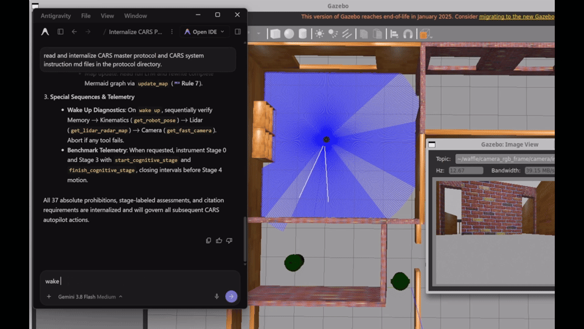
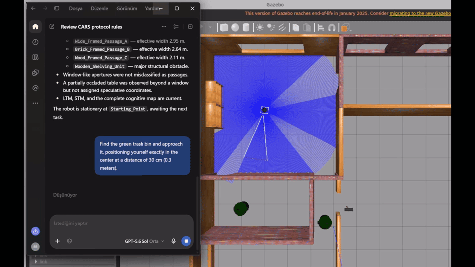
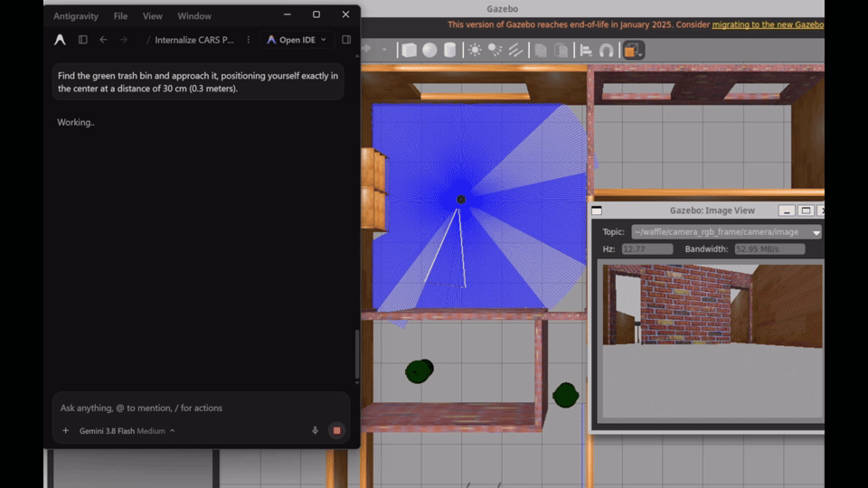
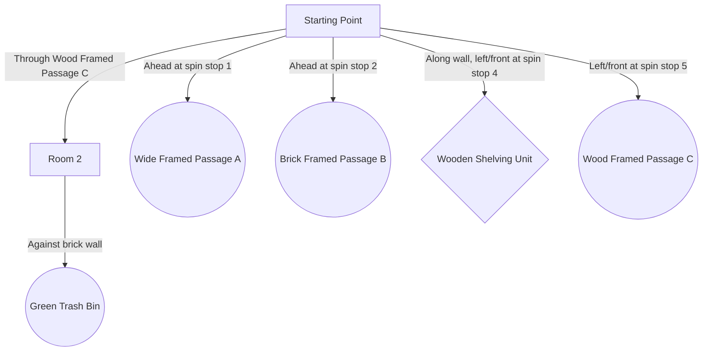
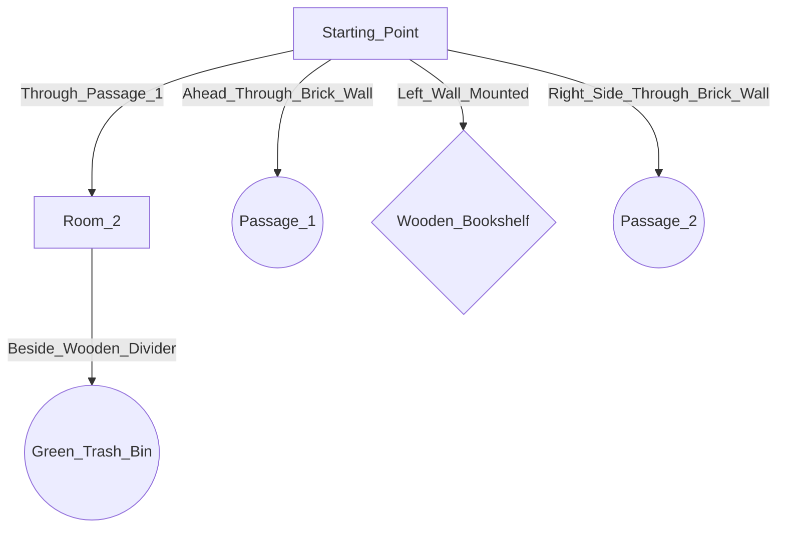

## Experiment 3: Passage Navigation & Multi-Door Choice (CARS Protocol)

In this scenario, the robot is placed in a separate room from the target. It must autonomously survey the environment, evaluate multiple doorway candidates, and select a safe passage to reach the target in the adjacent room.

### Preparatory 360° Exploration Spin
In Experiment 3, Pose 2, all four model/protocol conditions received a separately requested six-stop survey before the target command. This CARS preview illustrates that preparation, not a guarantee of comprehensive mapping.

  
   
  <em>Timelapse of the initial environment survey.</em>

### Autonomous Route Selection & Target Approach
The two CARS runs selected different routes and eligible bins: GPT chose the left passage and Gemini the right passage in the overhead view. Final reported target ranges were 0.31 m and 0.37 m respectively, within the accepted 0.30 m +/- 0.15 m tolerance.

| GPT (Selected Left Passage) | Gemini (Selected Right Passage) |
| :---: | :---: |
|  |  |
| *GPT navigates through Wood Framed Passage C.* | *Gemini navigates through Passage 1.* |

### Generated Cognitive Topological Maps
These are agent-authored Mermaid maps saved by Cartographer, not automatically generated from LTM. GPT labels below use display-friendly spacing; original outputs are preserved in [GPT map](cognitive_map_gpt_cars.md) and [Gemini map](cognitive_map_gemini_cars.md).

#### GPT Map

#### Gemini Map

